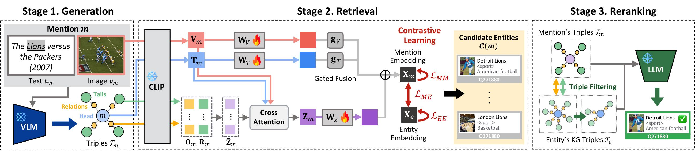

# KGMEL: Knowledge Graph-Enhanced Multimodal Entity Linking

[](https://arxiv.org/abs/2504.15135)
[](https://huggingface.co/papers/2504.15135)

Official Repository for our paper "KGMEL: Knowledge Graph-Enhanced Multimodal Entity Linking" (SIGIR 2025 Short)



## Setup 

### 0. Data Preparation

Our dataset is based on the [MIMIC repository](https://github.com/pengfei-luo/MIMIC).  
You need to download the following files from Our [GoogleDrive](https://drive.google.com/drive/folders/1cNrrFvFsNSej2QX8X6B1f1KyPDxqVINj?usp=sharing):
- `triple.tar.gz` - Knowledge graph triples 
- `mention_image.tar.gz` - Mention images 
- `kb_image.tar.gz` - Knowledge base entity images

Then, extract the files:
```bash
# Extract mention images for datasets
tar -xf mention_image.tar.gz -C data/dataset/

# Extract Knowledge Base images
tar -xf kb_image.tar.gz -C data/KB/

# Extract Knowledge Graph triples
tar -xf triple.tar.gz -C data/KB/
```


### 1. Install Dependencies
Install the required Python packages:
```bash
pip install -r requirements.txt
```

### 2. Set Keys and Tokens
Set up the necessary API keys and tokens:
```bash
# Set OpenAI API key
export OPENAI_API_KEY="your_openai_api_key"
# Set Hugging Face token
export HUGGINGFACE_TOKEN="your_huggingface_token"
# Set Hugging Face cache directory (optional)
export HUGGINGFACE_HUB_CACHE="/path/to/huggingface/cache"
# Set the WANDB_API_KEY environment variable
export WANDB_API_KEY="your_wandb_api_key"
# Login to Hugging Face (alternative method)
# huggingface-cli login
# Login to Weights & Biases (alternative method)
# wandb login
```
You can add these to your `.bashrc` or `.bash_profile` for persistence, or include them in your run script for convenience.

### 3. Run the Code
Execute the run script:
```bash
./run.sh
```

## Structure
```
KGMEL/
├── checkpoints/         # Directory for saving trained models
├── data/
│   ├── dataset/        # Contains the 3 MEL datasets (WikiMEL, WikiDiverse, RichpediaMEL)
│   │   ├── image/      # Contains extracted image datasets from mention_image.tar
│   │   ├── mapping/    # Contains mapping files for dataset processing
│   │   ├── RichpediaMEL.json
│   │   ├── WikiDiverse.json
│   │   └── WikiMEL.json
│   └── KB/              # Contains Knowledge Base data with including KG triples
│       ├── image/       # Contains extracted image datasets from kb_image.tar
│       ├── PID2Label.tsv
│       ├── QID2Label.tsv
│       ├── Triples-RichpediaMEL.tsv  # These triple files come from triples.tar.gz
│       ├── Triples-WikiDiverse.tsv
│       └── Triples-WikiMEL.tsv
├── embedding/           # Directory for pre-computed embeddings
├── module/
│   ├── generate.py      # Triple Generation module
│   ├── retrieve.py      # Candidate Entity Retrieval module
│   └── rerank.py        # Entity Reranking module
├── output/              # Output directory for results
├── utils/
│   ├── dataloader.py
│   ├── embedding_processor.py
│   ├── encoder.py
│   ├── evaluate.py
│   ├── train.py
│   ├── triple_filtering.py
│   └── triple_parser.py
├── main.py              # Main code 
├── requirements.txt     # Dependencies
└── run.sh               # Execution script
```

## Citation
```
@inproceedings{kim2025kgmel,
  title={KGMEL: Knowledge Graph-Enhanced Multimodal Entity Linking},
  author={Kim, Juyeon and Lee, Geon and Kim, Taeuk and Shin, Kijung},
  booktitle={Proceedings of the 48th International ACM SIGIR Conference on Research and Development in Information Retrieval},
  year={2025}
}
```
